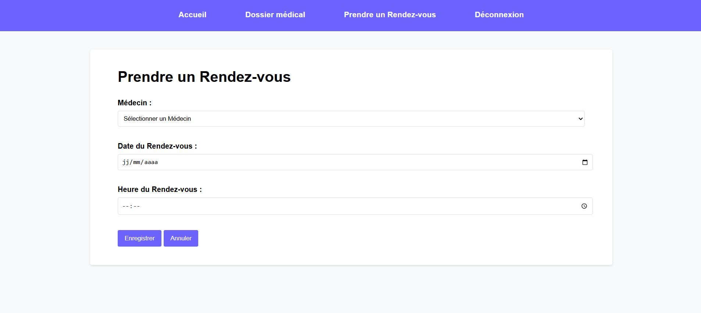
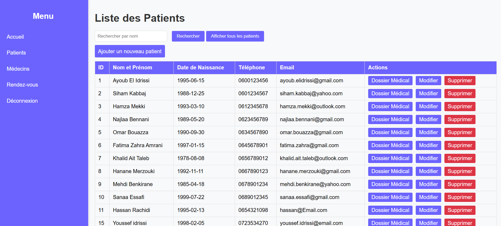
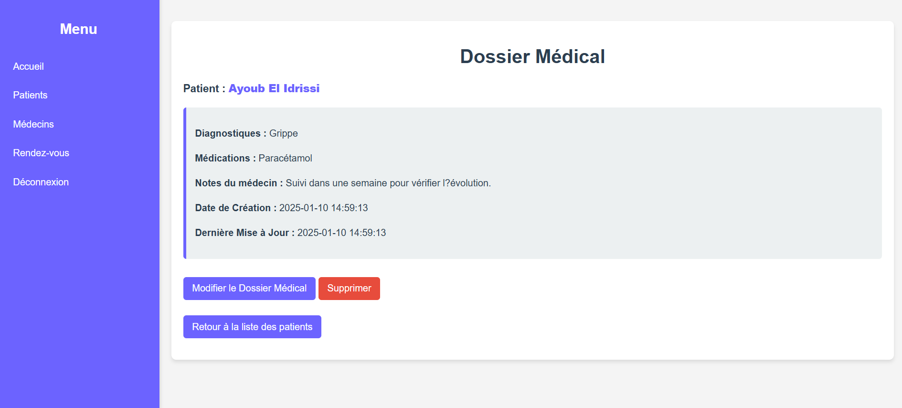
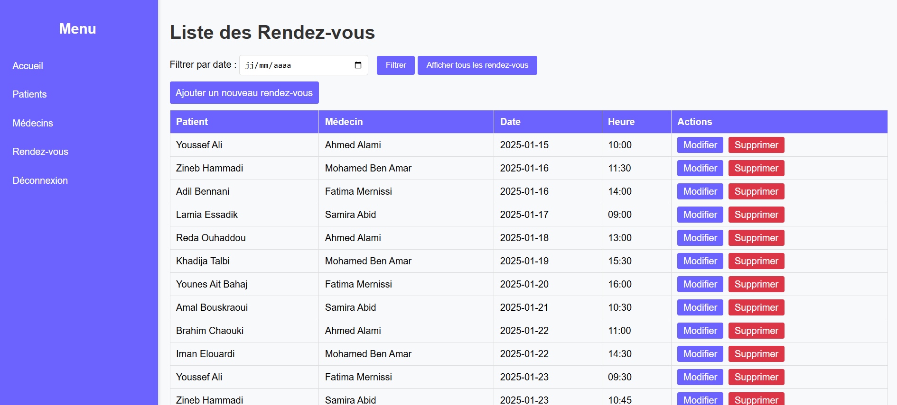

# Medical Office

Application web de gestion d’un cabinet médical réalisée dans le cadre d’un projet académique J2EE. Elle regroupe la gestion des patients, des médecins, des rendez-vous et des dossiers médicaux.

`Java 23` · `Jakarta Servlet` · `JSP / JSTL` · `JDBC` · `MySQL` · `Tomcat 11`

## Fonctionnalités

| Fonctionnalité | Ce que permet l’application |
|---|---|
| **Comptes** | Se connecter comme administrateur, médecin ou patient. Les patients peuvent aussi créer un compte. |
| **Patients et médecins** | Consulter, ajouter et modifier les fiches. |
| **Rendez-vous** | Planifier un rendez-vous, le modifier et consulter les réservations. |
| **Dossiers médicaux** | Créer, consulter et mettre à jour les dossiers associés aux patients. |

## Architecture

Le projet suit une organisation **MVC**. Les servlets reçoivent les requêtes HTTP et traitent les formulaires. Les DAO exécutent les requêtes SQL via JDBC. Les pages JSP affichent les données préparées par les contrôleurs.

| Dossier | Rôle |
|---|---|
| `src/java/controller/` | Servlets et traitement des requêtes |
| `src/java/model/` | Modèles Java du cabinet |
| `src/java/dao/` | Accès à la base via JDBC |
| `web/jsp/` | Pages et formulaires |
| `database/` | Schéma MySQL et données fictives de démonstration |

## Installation locale

### Prérequis

- JDK 23
- Apache NetBeans avec le support des projets web Ant
- Apache Tomcat 11
- MySQL

### 1. Initialiser la base de démonstration

Sur une instance MySQL de test, exécuter les scripts dans cet ordre.

1. `database/schema.sql` crée la base `medical_office` et ses tables.
2. `database/data.sql` ajoute trois comptes fictifs, un rendez-vous et un dossier médical.

### 2. Configurer le projet dans NetBeans

1. Dans **File → Open Project**, sélectionner le dossier qui contient `build.xml`.
2. Sélectionner le **JDK 23** dans les propriétés du projet et **Apache Tomcat 11** dans **Properties → Run**.
3. Si NetBeans signale des bibliothèques manquantes, rattacher **MySQL Connector/J 9.1.0**, **Jakarta JSTL API 3.0.0** et **l’implémentation Jakarta JSTL 3.0.0** dans **Properties → Libraries**.
4. Dans sa copie locale de `src/java/utils/DatabaseConnection.java`, renseigner les identifiants MySQL. La configuration d’exemple cible `localhost:3306/medical_office`.

### 3. Lancer l’application

Dans **Properties → Run**, renseigner `/cabinet-medical` dans **Context Path** et `/authServlet` dans **Relative URL**. Lancer **Clean and Build**, puis **Run**. Si Tomcat écoute sur le port `8080`, ouvrir `http://localhost:8080/cabinet-medical/authServlet`.

## Démonstration

Les comptes suivants sont disponibles après l’import de `data.sql`. Le mot de passe est `password` pour les trois comptes.

| Profil | Identifiant |
|---|---|
| Administrateur | `admin` |
| Médecin | `medecin_demo` |
| Patient | `patient_demo` |

Pour découvrir l’application, se connecter comme administrateur, ouvrir la liste des patients, puis consulter le dossier de **Patient Démo**. Le rendez-vous associé apparaît dans la liste des rendez-vous. Le compte `patient_demo` permet ensuite de découvrir le formulaire de réservation côté patient.

## Aperçu de l’application

### Page d'accueil du patient

### Prendre un rendez-vous

### Gestion des patients

### Dossiers médicaux

### Gestion des rendez-vous

